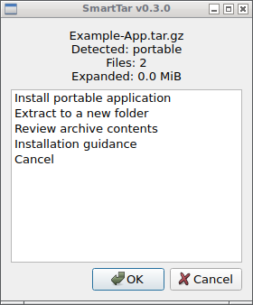
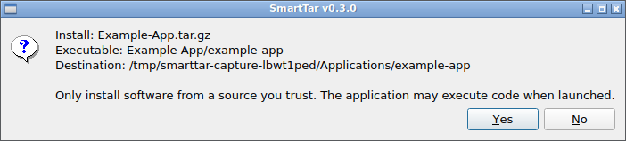
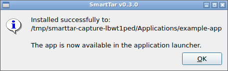
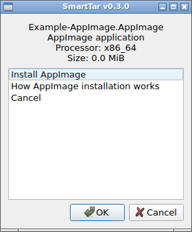
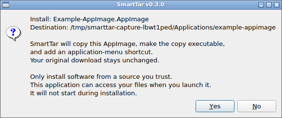
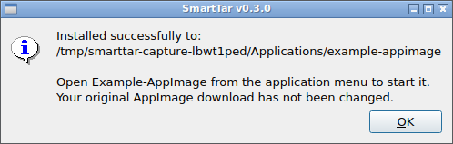

# SmartTar

**Install downloaded Linux apps with a few clicks.**

Version 0.4.0 · Testing · CachyOS and Arch Linux · KDE Plasma and DEsk

I built SmartTar for people who want to install a downloaded program without working out terminal commands. After the one-time setup, open a `.tar.gz`, `.tgz`, or `.AppImage` download with SmartTar, choose the install option, and confirm. The installed app appears in your application menu.

For example, if a Linux app's website gives you an unfamiliar download and you do not know what to do with it, SmartTar checks whether it recognizes a supported app. For a supported archive, it unpacks the program. For an AppImage, it saves a copy in a permanent location and makes a menu shortcut. You confirm before either installation begins.

**Download it. Open it. Install it.** No terminal commands are needed for ordinary use with supported app downloads.

[Download SmartTar](https://github.com/HaytamElbouhmidi/smarttar/archive/refs/heads/main.zip) · [Screenshots](#screenshots) · [One-time setup](#installation) · [Technical details](docs/TECHNICAL.md)

## What does it do?

A `.tar.gz` file is a bundle of files packed together to make the download smaller, similar to a ZIP. Some contain programs that are ready to use. Others contain documents, installer scripts, or source code, the files a developer uses to build a program. The word **archive** in SmartTar means this downloaded bundle.

A `.AppImage` file is a Linux app packaged as one file. SmartTar handles the usual setup for you, so you do not need to change its permissions yourself or remember where you left it in Downloads.

SmartTar looks inside the download and offers the options that fit:

- **Install an app:** Save a supported program on your computer for your own use and add a shortcut to your application menu.
- **Unpack an archive:** Put the contents of a `.tar.gz` or `.tgz` file into a new folder.
- **Get guidance:** Show what to do when the download needs a different installation method.

It asks before making changes. Opening a download **with SmartTar** does not run its programs or scripts. SmartTar does not check whether a publisher is trustworthy, so only install downloads from sources you trust.

## Everyday use

### 1. Open your download

Download a Linux app from a website you trust.

- **`.tar.gz` or `.tgz`:** Double-click the file in Dolphin, the file manager.
- **`.AppImage`:** Right-click the file, choose **Open With**, and select **SmartTar**. You can also double-click when your desktop has SmartTar set as the handler.

Some desktops run an executable AppImage directly when you double-click it. Use **Open With SmartTar** when you want to install it instead. Both `.AppImage` and `.appimage` filenames are accepted.

### 2. Choose Install

For an AppImage, choose **Install AppImage**. SmartTar saves a copy in its own application folder, allows that copy to run, and creates a menu shortcut. The original download is left unchanged. You can remove the original from Downloads after confirming that the installed copy opens correctly.

For an archive containing a supported ready-to-run program, choose **Install portable application** or the named install option. Here, portable means the app can run from its own folder.

If an archive has no install option, choose **Extract to a new folder** or **Installation guidance**. AppImages are installed as a single file, not unpacked by SmartTar.

### 3. Confirm and open the app

Review the destination, the folder where the program will be saved, and confirm. Once installation finishes, open the app from your normal application menu, where you find your other programs. You do not need to keep SmartTar open.

If SmartTar lists several programs and you are unsure which one to choose, cancel and check the publisher's instructions.

Large archives can take time to check before the first window appears. AppImage inspection only reads a small file header, so it does not scan or unpack the whole app before showing its options. Copying a large AppImage can still take time. This version does not yet show a progress bar.

## Screenshots

These screenshots show SmartTar v0.3.0 installing an archive and an AppImage. Both flows ask for confirmation before installation.

### Choose what to do

Open a download and select an available install option, unpack its files, or get guidance.



### Review and confirm

Check which program will be installed and where it will be placed. Choose **Yes** only if you trust the download.



### Find the app in your menu

After installation, SmartTar confirms that the app has an entry in the application menu.



### Install an AppImage

Right-click the downloaded file, open it with SmartTar, and choose **Install AppImage**.



Review where the app will be saved and choose **Yes** if you trust the download. SmartTar copies the file and adds a menu shortcut without starting the app.



Open the new entry in your application menu when you are ready to use it. Your original download is still where you left it.



These are real SmartTar dialogs captured in an automated Ubuntu test session, not mockups. The example downloads are synthetic test files, so these images demonstrate the installer rather than a particular app's ability to run. Colors and window borders depend on your desktop theme. The temporary destination shown is only for the test. See the [capture details](docs/screenshots/capture.json).

## Installation

**Package updates are available.** On November 25, 2026, the signed update source, fresh installation, and migration from an earlier setup passed an isolated Arch test. See the [successful verification run](https://github.com/HaytamElbouhmidi/smarttar/actions/runs/45696716737). Testing on a real CachyOS laptop is still needed.

### One-time setup

**Run the setup command once.** After that, SmartTar's own updates can arrive with your normal system updates. Everyday use stays graphical.

1. Use **Download SmartTar** above and extract the ZIP. Extract means unpacking its contents into a normal folder. Do not try to run the installer from inside the ZIP viewer.
2. Open the extracted folder containing `install.sh` in Dolphin.
3. Right-click inside the folder and choose **Open Terminal Here**. A terminal is a window where you enter commands.
4. Copy and paste:

   ```bash
   bash install.sh
   ```

   Start it as your normal user, without putting `sudo` before the command. The installer requests administrator permission for the package setup, then configures your desktop as your normal user. It runs a full system update while installing SmartTar, so read the package list and prompts before continuing.

5. Close the terminal and double-click `examples/smarttar-smoke-test.tar.gz` in the extracted project folder. SmartTar should open and offer to unpack its text file.

This adds the **SmartTar project’s signed update source** to Pacman, the package manager used by CachyOS and Arch. It is maintained by this project, not an official Arch or CachyOS repository. Signing allows Pacman to reject packages or update lists that do not have the expected trusted signature.

Only SmartTar's setup and package updates need administrator permission. Installing downloaded apps through SmartTar still saves them in your own user account.

If setup reports a warning or opening an archive still starts Ark, see [troubleshooting](docs/TECHNICAL.md#diagnostics-and-command-line-extraction).

### Already using SmartTar?

Run the new `bash install.sh` once from the latest extracted folder. This moves SmartTar itself from the earlier manually copied installation to the package-managed installation. Your installed apps, original downloads, and application shortcuts are kept.

Close and reopen Dolphin afterward. Future SmartTar releases can then be installed with normal system updates instead of downloading another ZIP each time. The earlier SmartTar program is kept as a backup, and any file-opening preferences you changed are preserved.

To check which version is installed, run:

```bash
smarttar --version
```

The package for this release reports `0.4.0`. If setup says the package installed but desktop migration did not finish, run `smarttar --migrate` as your normal user. If it reports a customized handler, stop and review it rather than deleting your settings.

### How do updates work?

Update CachyOS or Arch as you normally would. If you use the terminal, the usual full-system update is:

```bash
sudo pacman -Syu
```

When a new SmartTar package has been published, Pacman includes it in that update. The command can also update other installed system packages. SmartTar does not run a background updater or silently update itself between your system updates.

**This updates SmartTar, not the apps you installed with SmartTar.** Those apps still need their own updater or a newer download from their publisher. A new commit on GitHub is not automatically a published package update.

### Prefer a manual installation?

If you do not want to add a package repository, install the requirements and use manual mode:

```bash
sudo pacman -S --needed python kdialog xdg-utils
bash install.sh --manual
```

Manual mode installs SmartTar only for your user account and does not add the update source. It does not receive SmartTar updates through Pacman. To update it, download the latest ZIP and rerun `bash install.sh --manual`. Manual mode refuses to install over the package-managed version because that could hide its updates.

### Try it with an AppImage

1. Download an AppImage for your computer from the app's official website.
2. Right-click it in Dolphin and select **Open With SmartTar**.
3. Choose **Install AppImage**, review the destination, and confirm.
4. Open your application menu and launch the new entry.
5. Confirm that the original file is still in Downloads and the menu entry opens the installed copy.

After the one-time setup, these steps do not require a terminal. If SmartTar reports the wrong processor type, download the version that matches your computer. If installation succeeds but the app does not open, check the publisher's Linux requirements and [AppImage troubleshooting](docs/TECHNICAL.md#appimage-troubleshooting).

## What if there is no Install button?

Not every compressed download contains a ready-to-run app. Some need to be built from source or installed through another tool. SmartTar can unpack those files and offer guidance, but it does not silently run unfamiliar installers.

It also does not automatically download missing libraries or make a Windows program run on Linux. The publisher's requirements still apply.

SmartTar recognizes standard AppImages with a supported file header. A renamed file, an invalid header, or an older AppImage without that header is not accepted just because its name ends in `.AppImage`.

## Is it lightweight?

Yes. SmartTar uses one small Python program and the system's Python and KDE components. The package-managed option uses Pacman for updates instead of adding another updater.

- No background service, tray app, or startup process.
- No bundled browser or Python runtime.
- Nothing stays running when SmartTar is closed.
- An installed app opens directly, without starting SmartTar again.

The published v0.4.0 package is 24,609 bytes, about 24 KiB. Pacman reports about 0.07 MiB installed for SmartTar itself. These figures exclude system dependencies and any apps you install with SmartTar.

## Why are there checks?

The automated tests on GitHub run on GitHub's computers, not on yours. They are not run when you open a download. The installed app does not include or run the development tests, benchmarks, or screenshot tools.

SmartTar does check each archive before installation and while unpacking it. This helps catch damaged files, unsafe paths, and accidental overwrites. These checks add some processing time for large downloads, but there is no background scanning.

AppImages take a shorter route. SmartTar checks the file header and processor type, then copies the file once when you confirm. It checks for changes during that same copy, without a separate full-file scan. It does not run the AppImage to inspect it or extract an icon. The menu entry uses a generic application icon.

See the [measurements and technical details](docs/TECHNICAL.md#performance-measurements) if you want the numbers.

## Current status

This is a testing release, so you may still run into problems. Automated checks do not replace testing on real CachyOS, KDE Plasma, and DEsk setups. SmartTar can install programs it recognizes as ready to use, not every possible archive or AppImage. A successful installation does not guarantee that the app has all the system libraries it needs to run.

The signed package setup and migration passed automated checks using the actual public update source. Because v0.4.0 is the first package release, updating from one published SmartTar version to another has not yet been tested. The screenshots show the actual v0.3.0 app-installation dialogs, which are separate from package setup.

The detailed compatibility list, size limits, diagnostics, benchmark results, and removal instructions are in [the technical guide](docs/TECHNICAL.md). Package publishing and signing are covered in the [maintainer guide](docs/MAINTAINERS.md).

## License

MIT license. Copyright (c) 2026 Haytam Elbouhmidi, Mechanical Engineer.

See [LICENSE](LICENSE) and [CHANGELOG.md](CHANGELOG.md).
