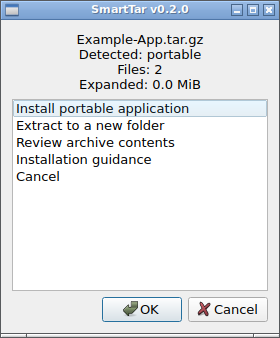
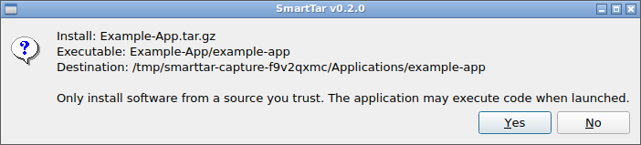
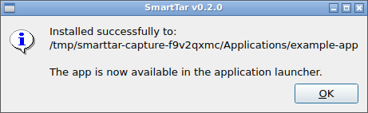

# SmartTar

**Install downloaded Linux apps with a few clicks.**

Version 0.2.0 · Testing · CachyOS and Arch Linux · KDE Plasma and DEsk

I built SmartTar for people who want to install a downloaded program without working out terminal commands. After the one-time setup, double-click a `.tar.gz` or `.tgz` download, choose an available install option, and confirm. The installed app appears in your application menu.

For example, if a Linux app's website gives you a `.tar.gz` download and you do not know what to do with it, SmartTar checks whether the app can be installed from that download. If it can, you confirm the installation in a window. If it cannot, SmartTar offers to unpack the files or explain the next steps.

**Download it. Open it. Install it.** No terminal commands are needed for ordinary use with supported app downloads.

[Download SmartTar](https://github.com/HaytamElbouhmidi/smarttar/archive/refs/heads/main.zip) · [Screenshots](#screenshots) · [One-time setup](#installation) · [Technical details](docs/TECHNICAL.md)

## What does it do?

A `.tar.gz` file is a bundle of files packed together to make the download smaller, similar to a ZIP. Some contain programs that are ready to use. Others contain documents, installer scripts, or source code, the files a developer uses to build a program. The word **archive** in SmartTar means this downloaded bundle.

SmartTar looks inside the download and offers the options that fit:

- **Install an app:** Save a supported program on your computer for your own use and add a shortcut to your application menu.
- **Unpack files:** Put the contents into a new folder.
- **Get guidance:** Show what to do when the download needs a different installation method.

It asks before making changes. Opening a download does not automatically run its programs or scripts.

## Everyday use

### 1. Open your download

Download a Linux app from a website you trust, then double-click its `.tar.gz` or `.tgz` file in Dolphin, the file manager.

### 2. Choose Install

If the archive contains a supported ready-to-run program, choose **Install portable application** or the named install option. Here, portable means the app can run from its own folder.

If installation is not offered, choose **Extract to a new folder** or **Installation guidance**.

### 3. Confirm and open the app

Review the destination, the folder where the program will be saved, and confirm. Once installation finishes, open the app from your normal application menu, where you find your other programs. You do not need to keep SmartTar open.

If SmartTar lists several programs and you are unsure which one to choose, cancel and check the publisher's instructions.

Large downloads can take time to check before the first window appears. This version does not yet show a progress bar.

## Screenshots

### Choose what to do

Open a download and select an available install option, unpack its files, or get guidance.



### Review and confirm

Check which program will be installed and where it will be placed. Choose **Yes** only if you trust the download.



### Find the app in your menu

After installation, SmartTar confirms that the app has an entry in the application menu.



These are real SmartTar dialogs captured in an automated Ubuntu test session with an example app, not mockups. Colors and window borders depend on your desktop theme. The temporary destination shown is only for the test. See the [capture details](docs/screenshots/capture.json).

## Installation

### One-time setup

**The current setup still requires two terminal commands.** You only do this to install SmartTar or update it. Everyday use is graphical after setup.

1. Use **Download SmartTar** above and extract the ZIP. Extract means unpacking its contents into a normal folder. Do not try to run the installer from inside the ZIP viewer.
2. Open the extracted folder containing `install.sh` in Dolphin.
3. Right-click inside the folder and choose **Open Terminal Here**. A terminal is a window where you enter commands. You can copy the two commands below as written.
4. Copy and paste this command to install any missing requirements. Enter your Linux password if asked:

   ```bash
   sudo pacman -S --needed python kdialog xdg-utils
   ```

5. Run the SmartTar installer:

   ```bash
   bash install.sh
   ```

   Do not put `sudo` before this second command. SmartTar installs for your own user account.

6. Close the terminal and double-click `examples/smarttar-smoke-test.tar.gz` in the extracted project folder. SmartTar should open and offer to unpack its text file.

An update can be installed over an earlier version. If setup reports a warning or opening an archive still starts Ark, see [troubleshooting](docs/TECHNICAL.md#diagnostics-and-command-line-extraction).

## What if there is no Install button?

Not every compressed download contains a ready-to-run app. Some need to be built from source or installed through another tool. SmartTar can unpack those files and offer guidance, but it does not silently run unfamiliar installers.

It also does not automatically download missing libraries or make a Windows program run on Linux. The publisher's requirements still apply.

## Is it lightweight?

Yes. The installer copies one small Python program, using the Python and KDE components already on the system when available.

- No background service, tray app, or startup process.
- No bundled browser or Python runtime.
- Nothing stays running when SmartTar is closed.
- An installed app opens directly, without starting SmartTar again.

## Why are there checks?

The automated tests on GitHub run on GitHub's computers, not on yours. They are not run when you open a download. Tests, screenshots, and this documentation are not copied into the installed app.

SmartTar does check each archive before installation and while unpacking it. This helps catch damaged files, unsafe paths, and accidental overwrites. These checks add some processing time for large downloads, but there is no background scanning.

See the [measurements and technical details](docs/TECHNICAL.md#performance-measurements) if you want the numbers.

## Current status

This is a testing release, so you may still run into problems. Automated Linux tests have passed, but more testing on real CachyOS, KDE Plasma, and DEsk setups is needed. SmartTar can install programs it recognizes as ready to use, not every possible `.tar.gz` file.

The detailed compatibility list, size limits, diagnostics, benchmark results, and removal instructions are in [the technical guide](docs/TECHNICAL.md).

## License

MIT license. Copyright (c) 2026 Haytam Elbouhmidi, Mechanical Engineer.

See [LICENSE](LICENSE) and [CHANGELOG.md](CHANGELOG.md).
